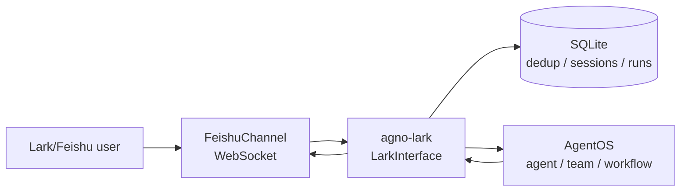

# agno-lark

A lightweight Python bridge between Lark/Feishu IM and Agno AgentOS.

`agno-lark` (import package: `agno_lark`) runs as an independent bridge process. It uses the official `lark-channel-sdk` WebSocket channel to receive Lark/Feishu messages, forwards them to an AgentOS agent, team, or workflow, and stores deduplication, session generations, and run records in SQLite.



The Chinese documentation is available in [`READM_ZH.md`](READM_ZH.md).

## Features

- Persistent Lark/Feishu WebSocket connection; HTTP webhook mode is not required.
- Direct messages and group messages that mention the bot.
- Text replies, image resources, and file resources converted to Agno media objects.
- Remote AgentOS targets for `agent`, `team`, and `workflow`.
- User, chat, and thread session isolation with `/new` generation resets.
- Configurable group context:
  - `user` (default): each member who mentions the bot gets an independent context.
  - `shared`: members share one context for the same chat and thread.
- SQLite message deduplication, run records, TTL cleanup, WAL, and busy-timeout handling.
- Streaming Feishu cards with status, run ID, elapsed time, and cancellation actions.
- `/new`, `/status`, `/cancel [run_id]`, and `/help` commands.
- User and chat allowlists, reconnect handling, error handling, and structured logging.

The first release does not process audio, video, or voice messages and does not implement HITL resume approval. Long-running tasks use foreground SSE streaming.

## Requirements and installation

Python 3.12 or newer (and lower than 4.0) is required. [uv](https://docs.astral.sh/uv/) is recommended:

```bash
uv sync
cp .env.example .env
```

## Create the Lark/Feishu application

Create an enterprise application in the Lark or Feishu Open Platform and enable bot capabilities. Record the App ID (`cli_...`) and App Secret. Select the long connection (WebSocket) mode in event subscriptions and subscribe to message events. Grant the permissions required to receive and send messages, read image/file resources, and send card messages. Publish the application and add the bot to the target chats.

The official Channel SDK handles the WebSocket connection, event normalization, resource downloads, deduplication, and card callbacks. This project does not require a separate webhook endpoint.

## Configuration

Copy `.env.example` and fill in the values below. The `FEISHU_*` prefix is retained for compatibility with existing Lark/Feishu application configuration; the distribution and import names are `agno-lark` and `agno_lark`.

```dotenv
FEISHU_APP_ID=cli_xxx
FEISHU_APP_SECRET=xxx

AGENTOS_URL=http://127.0.0.1:7777
AGENTOS_TOKEN=xxx
AGENTOS_TARGET_TYPE=agent
AGENTOS_TARGET_ID=assistant
# Legacy alias for an agent target:
# AGENTOS_AGENT_ID=assistant

FEISHU_STATE_DB=.data/agno-feishu.sqlite3
FEISHU_ALLOWED_USER_IDS=
FEISHU_ALLOWED_CHAT_IDS=
# user (default: one context per member) or shared (one context per chat/thread)
FEISHU_GROUP_SESSION_MODE=user

BRIDGE_HOST=127.0.0.1
BRIDGE_PORT=7788
```

Allowlist values are comma-separated. If both allowlists are empty, access is open; production deployments should configure at least one allowlist. `AGENTOS_TOKEN` may be empty for a public AgentOS, but a Bearer token is recommended for production.

`FEISHU_GROUP_SESSION_MODE` affects group chats only. In `user` mode, the scope includes `sender.open_id`; in `shared` mode, the scope includes the chat and thread but not the sender. Direct messages are always isolated by their direct-message chat. The default SQLite filename remains `.data/agno-feishu.sqlite3` so existing state data can be reused.

## Quick start with a remote AgentOS

Start AgentOS at `AGENTOS_URL`, then run the bridge:

```bash
uv run agno-lark
uv run agno-lark --host 0.0.0.0 --port 7788
```

The bridge creates a `RemoteAgent`, `RemoteTeam`, or `RemoteWorkflow` from `AGENTOS_TARGET_TYPE` and mounts the Lark/Feishu interface into the local AgentOS gateway. The status endpoint is `GET /feishu/status`; this path is retained for compatibility with existing deployments.

## Embed in an existing AgentOS application

```python
from agno.os import AgentOS
from agno_lark import LarkInterface, build_remote_target, load_settings

settings = load_settings()
target = build_remote_target(settings)
lark = LarkInterface(target=target, settings=settings)

agent_os = AgentOS(
    agents=[target] if settings.target_type == "agent" else None,
    teams=[target] if settings.target_type == "team" else None,
    workflows=[target] if settings.target_type == "workflow" else None,
    interfaces=[lark],
)
app = agent_os.get_app()
```

`LarkInterface.get_router()` returns a FastAPI `APIRouter` with a managed lifespan. Startup opens the SQLite store and connects `FeishuChannel`; shutdown disconnects the channel and closes the store. Only the asynchronous AgentOS execution path is supported. `FeishuInterface` remains exported as a compatibility alias.

## Messages, sessions, and commands

- Direct messages are handled immediately; group messages must mention the bot.
- `user_id` is taken from `sender.open_id`.
- In the default `user` group mode, a scope can look like `feishu:agent:assistant:chat_oc_xxx:thread_omt_xxx:user:ou_xxx:v3`.
- In `shared` group mode, the same chat/thread uses a scope such as `feishu:agent:assistant:chat_oc_xxx:thread_omt_xxx:v3` for every member, while each AgentOS run still receives the sender's `user_id`.
- `/new` increments the generation for the current user scope or shared chat/thread scope.

| Command | Behavior |
| --- | --- |
| `/new` | Increment the current scope generation and start a fresh session. |
| `/status` | Show active and recent runs for the current scope. |
| `/cancel` | Cancel the most recent active run for the current scope. |
| `/cancel <run_id>` | Request cancellation of a specific run. |
| `/help` | Show the command help card. |

Cancellation first records `cancel_requested` and then calls the scoped AgentOS cancel endpoint. The final state comes from the SSE terminal event. Card actions re-check the operator and chat allowlists before starting status or cancellation work.

## State database and troubleshooting

The default database `.data/agno-feishu.sqlite3` uses WAL and a busy timeout. It contains `schema_version`, `dedup_messages`, `session_scopes`, and `runs`. Message deduplication defaults to 24 hours and run records are retained for 7 days.

If no messages arrive, check application publication, WebSocket subscriptions, bot membership, and allowlists. For 401/403 responses, check the AgentOS token, target ID, and AgentOS authorization. For resource failures, check Lark/Feishu resource-read permissions. Logs do not include the App Secret, AgentOS token, raw file contents, or complete user messages.

If your shell exports a SOCKS proxy and the local environment does not have `socksio`, set `NO_PROXY=127.0.0.1,localhost` (and the AgentOS hostname) when testing a local AgentOS. If outbound AgentOS requests must use a SOCKS proxy, install the HTTPX SOCKS extra in the deployment environment with `uv pip install "httpx[socks]>=0.28,<1"`.

## Development

```bash
uv sync
uv run pytest
uv run ruff check .
uv run mypy src
uv build
uv run agno-lark --help
```

Tests use fake Channel and Agno targets plus `httpx` mocks; they do not contact Lark/Feishu or AgentOS. See [`examples/agent_os_remote.py`](examples/agent_os_remote.py) for the remote integration example.

## License

This project is released under the MIT License. See [`LICENSE`](LICENSE).
