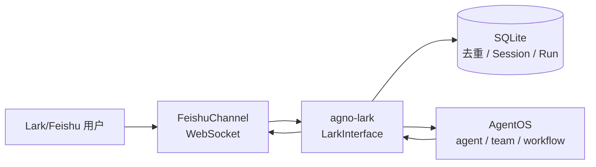

# agno-lark

English version: [`README.md`](README.md)

一个轻量的 Python Lark/Feishu 与 Agno AgentOS 桥接器。

> A lightweight Python bridge between Lark/Feishu and Agno AgentOS.

`agno-lark`（导入名 `agno_lark`）运行独立桥接进程，使用官方 `lark-channel-sdk` 的 WebSocket 长连接接收 Lark/Feishu IM 消息，转发给 AgentOS 的 agent、team 或 workflow，并把去重、Session generation 和运行记录保存到 SQLite。



## 首版功能

- Lark/Feishu WebSocket 长连接（不提供 HTTP Webhook 模式）。
- 私聊和群聊 `@机器人` 的文本消息接收与回复。
- 图片、文件资源下载并转换为 Agno 媒体对象。
- AgentOS URL、目标类型（`agent`、`team`、`workflow`）和目标 ID 配置。
- 用户、群聊、线程 Session 隔离；`/new` 创建新一代 Session。
- 群聊上下文支持按成员独立或按群聊 / 线程共享，默认按成员独立。
- SQLite 消息去重、运行记录、TTL 清理和 WAL。
- 流式卡片回复，显示运行状态、运行 ID、耗时和取消按钮。
- `/new`、`/status`、`/cancel [run_id]`、`/help` 命令。
- 用户和聊天白名单、自动重连、异常处理和结构化日志。

首版不处理音频、视频、语音或 HITL 继续审批流程；长任务使用前台 SSE 流式运行。

## 安装

要求 Python 3.12 或更高版本（小于 4.0），推荐使用 [uv](https://docs.astral.sh/uv/)：

```bash
uv sync
cp .env.example .env
```

发布到 PyPI 后，在已有项目中安装：

```bash
uv add agno-lark
# 或
python -m pip install agno-lark
```

分发包名使用连字符 `agno-lark`，Python 导入名使用下划线 `agno_lark`：

```python
from agno_lark import LarkInterface, build_remote_target, load_settings
```

安装后会同时提供 `agno-lark` 命令：

```bash
agno-lark --help
agno-lark
```

## 配置 Lark/Feishu 应用

在 Lark/Feishu 开放平台创建企业自建应用并启用机器人能力，记录 App ID（`cli_...`）和 App Secret；在事件订阅中选择长连接（WebSocket）并订阅接收消息事件；开通消息收发、读取消息资源和发送卡片消息所需权限；发布应用并把机器人加入目标群聊。官方 Channel SDK 负责 WebSocket、事件标准化、资源下载、去重和卡片回调，不需要额外实现回调 Webhook。

## 环境变量

复制 `.env.example` 后填写：

`FEISHU_*` 环境变量前缀沿用 Lark/Feishu 开放平台的历史命名，项目分发包和 Python 导入名已经统一为 `agno-lark` / `agno_lark`。

```dotenv
FEISHU_APP_ID=cli_xxx
FEISHU_APP_SECRET=xxx
AGENTOS_URL=http://127.0.0.1:7777
AGENTOS_TOKEN=xxx
AGENTOS_TARGET_TYPE=agent
AGENTOS_TARGET_ID=assistant
# 兼容旧配置：AGENTOS_AGENT_ID=assistant
FEISHU_STATE_DB=.data/agno-feishu.sqlite3
FEISHU_ALLOWED_USER_IDS=
FEISHU_ALLOWED_CHAT_IDS=
# user（默认：每个成员独立上下文）或 shared（群聊 / 线程共享上下文）
FEISHU_GROUP_SESSION_MODE=user
BRIDGE_HOST=127.0.0.1
BRIDGE_PORT=7788
```

白名单使用逗号分隔。两个白名单都为空时默认开放；生产环境建议至少配置一个。`AGENTOS_TOKEN` 可以为空以兼容公开 AgentOS，生产环境建议启用 Bearer Token。
`FEISHU_GROUP_SESSION_MODE` 只影响群聊：`user` 为每个 `sender.open_id` 建立独立 Session，`shared` 为同一 `chat_id + thread_id` 共用 Session。私聊始终按私聊会话隔离。

## 快速接入远程 AgentOS

确保 AgentOS 已在 `AGENTOS_URL` 运行，然后启动桥接进程：

```bash
uv run agno-lark
uv run agno-lark --host 0.0.0.0 --port 7788
```

桥接器会根据 `AGENTOS_TARGET_TYPE` 创建 `RemoteAgent`、`RemoteTeam` 或 `RemoteWorkflow`，并通过 `LarkInterface` 挂载到本地 AgentOS gateway。状态端点为 `GET /feishu/status`（保留该路径以兼容既有部署）。

## 嵌入已有 AgentOS

```python
from agno.os import AgentOS
from agno_lark import LarkInterface, build_remote_target, load_settings

settings = load_settings()
target = build_remote_target(settings)
lark = LarkInterface(target=target, settings=settings)
agent_os = AgentOS(
    agents=[target] if settings.target_type == "agent" else None,
    teams=[target] if settings.target_type == "team" else None,
    workflows=[target] if settings.target_type == "workflow" else None,
    interfaces=[lark],
)
app = agent_os.get_app()
```

`LarkInterface.get_router()` 返回带生命周期的 FastAPI `APIRouter`；启动时连接 `FeishuChannel`，关闭时断开并关闭 SQLite。仅支持异步运行路径。为了兼容旧代码，`FeishuInterface` 仍作为别名导出。

## 消息、Session 和命令

- 私聊直接处理文本消息；群聊必须 `@机器人`。
- `user_id` 使用 `sender.open_id`。
- 默认 `FEISHU_GROUP_SESSION_MODE=user`：群聊 scope 由目标、`chat_id`、`thread_id` 和用户组成，例如 `feishu:agent:assistant:chat_oc_xxx:thread_omt_xxx:user:ou_xxx:v3`；同一群聊中不同成员拥有独立上下文。
- 设置 `FEISHU_GROUP_SESSION_MODE=shared` 后，群聊 scope 只由目标、`chat_id` 和 `thread_id` 组成，例如 `feishu:agent:assistant:chat_oc_xxx:thread_omt_xxx:v3`；同一群聊线程共享上下文，但每次运行仍会把发送者 `user_id` 传给目标。
- `/new` 只重置当前用户 Session（`user` 模式）或当前群聊 / 线程 Session（`shared` 模式）。

| 命令 | 作用 |
| --- | --- |
| `/new` | 当前 scope 的 generation 加一 |
| `/status` | 查看活动和最近运行 |
| `/cancel` | 取消当前 scope 最近活动运行 |
| `/cancel <run_id>` | 取消指定运行 |
| `/help` | 显示帮助 |

取消先写入 `cancel_requested`，再调用 AgentOS scoped cancel endpoint；最终状态以 SSE 终态事件为准。卡片按钮会校验操作者和聊天白名单。

## 状态数据库和排查

默认数据库 `.data/agno-feishu.sqlite3` 启用 WAL 和 busy timeout，包含 `schema_version`、`dedup_messages`、`session_scopes` 和 `runs`；去重默认 24 小时，运行记录默认保留 7 天。该文件名保留 `agno-feishu` 以兼容已有状态数据。没有消息时检查应用发布、WebSocket 订阅、机器人群成员资格和白名单；401/403 时检查 Token、目标 ID 和 AgentOS 鉴权；资源失败时检查 Lark/Feishu 资源读取权限。日志不会输出 App Secret、AgentOS Token、原始文件内容或完整用户消息。

如果终端设置了 SOCKS 代理，而当前环境没有安装 `socksio`，本地验证时请设置 `NO_PROXY=127.0.0.1,localhost`（以及 AgentOS 主机名）。如果 AgentOS 必须通过 SOCKS 代理访问，请在部署环境安装 HTTPX SOCKS 扩展：`uv pip install "httpx[socks]>=0.28,<1"`。

## 开发

```bash
uv sync
uv run pytest
uv run ruff check .
uv run mypy src
uv build
uv run agno-lark --help
```

测试使用 fake Channel、fake Agno target 和 `httpx` mock，不访问真实服务。远程接入示例见 [`examples/agent_os_remote.py`](examples/agent_os_remote.py)。

## 发布到 PyPI

项目计划以 `agno-lark` 发布到 PyPI，每个版本号只能发布一次。修改 `pyproject.toml` 中的 `version` 后，先执行完整检查和构建：

```bash
uv lock
uv sync --locked
uv run pytest
uv run ruff check .
uv run mypy src
uv build
```

手动发布时，在 PyPI 创建 API Token，并通过环境变量传给 uv，不要把 Token 写入仓库或命令历史：

```bash
export UV_PUBLISH_TOKEN='pypi-...'
uv publish
```

正式发布前可以先上传到 TestPyPI：

```bash
export UV_PUBLISH_TOKEN='pypi-...'
uv publish --publish-url https://test.pypi.org/legacy/
uv pip install --index-url https://test.pypi.org/simple/ --extra-index-url https://pypi.org/simple/ agno-lark
```

仓库还提供 GitHub Actions Trusted Publishing 工作流。在 PyPI 为 `agno-lark` 配置 GitHub 仓库可信发布者后，推送 `v0.1.0` 这类 tag 即可自动构建并发布，无需长期 PyPI Token。

## 许可证

本项目采用 MIT License，见 [`LICENSE`](LICENSE)。
