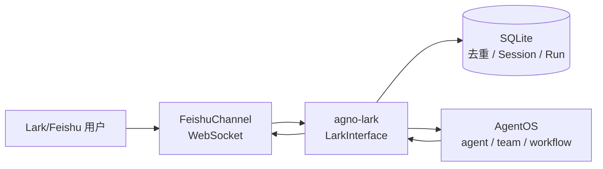

# agno-lark

English version: [`README.md`](README.md)

一个轻量的 Python Lark/Feishu 与 Agno AgentOS 桥接器。

> A lightweight Python bridge between Lark/Feishu and Agno AgentOS.

`agno-lark`（导入名 `agno_lark`）运行独立桥接进程，使用官方 `lark-channel-sdk` 的 WebSocket 长连接接收 Lark/Feishu IM 消息，转发给 AgentOS 的 agent、team 或 workflow，并把去重、Session generation 和运行记录保存到 SQLite。



## 首版功能

- Lark/Feishu WebSocket 长连接（不提供 HTTP Webhook 模式）。
- 私聊和群聊 `@机器人` 的文本消息接收与回复。
- 图片、文件资源下载并转换为 Agno 媒体对象。
- AgentOS URL、目标类型（`agent`、`team`、`workflow`）和目标 ID 配置。
- 用户、群聊、线程 Session 隔离；`/new` 创建新一代 Session。
- 群聊上下文支持按成员独立或按群聊 / 线程共享，默认按成员独立。
- SQLite 消息去重、运行记录、TTL 清理和 WAL。
- 流式卡片回复，显示运行状态、运行 ID、耗时和取消按钮。
- `/new`、`/status`、`/cancel [run_id]`、`/help` 命令。
- 用户和聊天白名单、自动重连、异常处理和结构化日志。
- 只读 Lark/Feishu 电子表格、多维表格、知识库和词典数据，可作为 AgentOS 工具或桥接命令使用。
- 支持 Agent、Team、Workflow 的 HITL 确认、拒绝、输入、反馈、外部执行和继续运行。

桥接器不处理音频、视频或语音。数据能力严格只读，默认使用机器人 tenant access token。

## 安装

要求 Python 3.12 或更高版本（小于 4.0），推荐使用 [uv](https://docs.astral.sh/uv/)：

```bash
uv sync
cp .env.example .env
```

发布到 PyPI 后，在已有项目中安装：

```bash
uv add agno-lark
# 或
python -m pip install agno-lark
```

分发包名使用连字符 `agno-lark`，Python 导入名使用下划线 `agno_lark`：

```python
from agno_lark import LarkInterface, build_remote_target, load_settings
```

安装后会同时提供 `agno-lark` 命令：

```bash
agno-lark --help
agno-lark
```

## 配置 Lark/Feishu 应用

在 Lark/Feishu 开放平台创建企业自建应用并启用机器人能力，记录 App ID（`cli_...`）和 App Secret；在事件订阅中选择长连接（WebSocket）并订阅接收消息事件；开通消息收发、读取消息资源和发送卡片消息所需权限；发布应用并把机器人加入目标群聊。官方 Channel SDK 负责 WebSocket、事件标准化、资源下载、去重和卡片回调，不需要额外实现回调 Webhook。

## 环境变量

复制 `.env.example` 后填写：

`FEISHU_*` 环境变量前缀沿用 Lark/Feishu 开放平台的历史命名，项目分发包和 Python 导入名已经统一为 `agno-lark` / `agno_lark`。

```dotenv
FEISHU_APP_ID=cli_xxx
FEISHU_APP_SECRET=xxx
AGENTOS_URL=http://127.0.0.1:7777
AGENTOS_TOKEN=xxx
AGENTOS_TARGET_TYPE=agent
AGENTOS_TARGET_ID=assistant
# 兼容旧配置：AGENTOS_AGENT_ID=assistant
FEISHU_STATE_DB=.data/agno-feishu.sqlite3
FEISHU_ALLOWED_USER_IDS=
FEISHU_ALLOWED_CHAT_IDS=
# user（默认：每个成员独立上下文）或 shared（群聊 / 线程共享上下文）
FEISHU_GROUP_SESSION_MODE=user
LARK_API_BASE_URL=https://open.feishu.cn
LARK_API_TIMEOUT=20
LARK_DATA_MAX_ROWS=100
LARK_DATA_MAX_CELLS=2000
LARK_DATA_MAX_CHARS=12000
LARK_BASE_PAGE_SIZE=50
BRIDGE_HOST=127.0.0.1
BRIDGE_PORT=7788
```

白名单使用逗号分隔。两个白名单都为空时默认开放；生产环境建议至少配置一个。`AGENTOS_TOKEN` 可以为空以兼容公开 AgentOS，生产环境建议启用 Bearer Token。
`FEISHU_GROUP_SESSION_MODE` 只影响群聊：`user` 为每个 `sender.open_id` 建立独立 Session，`shared` 为同一 `chat_id + thread_id` 共用 Session。私聊始终按私聊会话隔离。

## 快速接入远程 AgentOS

确保 AgentOS 已在 `AGENTOS_URL` 运行，然后启动桥接进程：

```bash
uv run agno-lark
uv run agno-lark --host 0.0.0.0 --port 7788
```

桥接器会根据 `AGENTOS_TARGET_TYPE` 创建 `RemoteAgent`、`RemoteTeam` 或 `RemoteWorkflow`，并通过 `LarkInterface` 挂载到本地 AgentOS gateway。状态端点为 `GET /feishu/status`（保留该路径以兼容既有部署）。

## 嵌入已有 AgentOS

```python
from agno.os import AgentOS
from agno_lark import LarkInterface, build_remote_target, load_settings

settings = load_settings()
target = build_remote_target(settings)
lark = LarkInterface(target=target, settings=settings)
agent_os = AgentOS(
    agents=[target] if settings.target_type == "agent" else None,
    teams=[target] if settings.target_type == "team" else None,
    workflows=[target] if settings.target_type == "workflow" else None,
    interfaces=[lark],
)
app = agent_os.get_app()
```

`LarkInterface.get_router()` 返回带生命周期的 FastAPI `APIRouter`；启动时连接 `FeishuChannel`，关闭时断开并关闭 SQLite。仅支持异步运行路径。为了兼容旧代码，`FeishuInterface` 仍作为别名导出。

## 消息、Session 和命令

- 私聊直接处理文本消息；群聊必须 `@机器人`。
- `user_id` 使用 `sender.open_id`。
- 默认 `FEISHU_GROUP_SESSION_MODE=user`：群聊 scope 由目标、`chat_id`、`thread_id` 和用户组成，例如 `feishu:agent:assistant:chat_oc_xxx:thread_omt_xxx:user:ou_xxx:v3`；同一群聊中不同成员拥有独立上下文。
- 设置 `FEISHU_GROUP_SESSION_MODE=shared` 后，群聊 scope 只由目标、`chat_id` 和 `thread_id` 组成，例如 `feishu:agent:assistant:chat_oc_xxx:thread_omt_xxx:v3`；同一群聊线程共享上下文，但每次运行仍会把发送者 `user_id` 传给目标。
- `/new` 只重置当前用户 Session（`user` 模式）或当前群聊 / 线程 Session（`shared` 模式）。

| 命令 | 作用 |
| --- | --- |
| `/new` | 当前 scope 的 generation 加一 |
| `/status` | 查看活动和最近运行 |
| `/cancel` | 取消当前 scope 最近活动运行 |
| `/cancel <run_id>` | 取消指定运行 |
| `/help` | 显示帮助 |

取消先写入 `cancel_requested`，再调用 AgentOS scoped cancel endpoint；最终状态以 SSE 终态事件为准。卡片按钮会校验操作者和聊天白名单。

## 读取电子表格、多维表格、知识库和词典

数据访问默认使用应用的 tenant access token，不实现 OAuth 用户 Token。需要同时开通应用权限并授予目标资源访问权：

| 资源 | 应用权限 | 资源访问权 |
| --- | --- | --- |
| 电子表格 | `sheets:spreadsheet:readonly` | 向应用共享目标表格。 |
| 多维表格 | `bitable:app:readonly` | 向应用共享目标 Base。 |
| 知识库 | `wiki:node:read`；读取 Docx 正文还需 `docx:document:readonly` | 将应用添加到知识库节点 / 文档，或授予知识空间访问权；列出子节点还需 `wiki:node:retrieve`。 |
| 飞书词典 | `baike:entity:readonly` | 企业自建应用可读取其可见词库；非全员词库需在「词库设置」中添加应用。 |

应用 scope 决定能否调用 API，资源授权决定能否访问指定文档、知识空间、Base 或词库，两者可能都需要。官方参考：[获取知识库节点](https://open.feishu.cn/document/server-docs/docs/wiki-v2/space-node/get_node.md)、[读取 Docx 纯文本](https://open.feishu.cn/document/server-docs/docs/docx-v1/document/raw_content.md)、[获取词库列表](https://open.feishu.cn/document/lingo-v1/repo/list.md)、[获取词条](https://open.feishu.cn/document/lingo-v1/entity/get.md)。

数据模块使用 `FEISHU_APP_ID` 和 `FEISHU_APP_SECRET` 创建独立的 `lark_oapi.Client`，
不复用 `FeishuChannel.client`。Token 通过异步接口获取并在过期前刷新，所有数据读取
共用该缓存。`LARK_API_TIMEOUT` 同时应用于数据 SDK 和直接 HTTP 请求，不需要手动
填写 tenant token 或执行用户登录授权。

`build_lark_data_client(settings, channel=...)` 为兼容保留 `channel` 参数，但不再使用其消息
客户端。如果通过 `LarkDataClient(settings, client=...)` 显式注入客户端，应传入支持异步
tenant 认证和所需 OpenAPI 服务的客户端，并使用 `.enable_set_token(True)` 构建。
这样请求才能使用异步获取的 token，避免 SDK 自动鉴权阻塞事件循环。
应用仍可通过 `LarkInterface(data_client=...)` 注入自己管理的数据访问对象。

```text
/sheet https://open.feishu.cn/sheets/shtxxxxxxxx Sheet1!A1:D20
/base https://open.feishu.cn/base/appxxxxxxxx tblxxxxxxxx
/base appxxxxxxxx tblxxxxxxxx keyword
/wiki https://example.feishu.cn/wiki/wikcnxxxxxxxx
/wiki https://example.feishu.cn/wiki/wikcnxxxxxxxx Sheet1!A1:D20
/wiki https://example.feishu.cn/wiki/wikcnxxxxxxxx tblxxxxxxxx [--page-token <cursor>]
/wiki ls <space_id> [parent_node_token] [page_token]
/wiki ls <space_id> [parent_node_token] --page-token <cursor>
/lingo 部署 [--page-token <cursor>]
/lingo https://example.feishu.cn/lingo/category?unit_id=...&primary_class=... [--page-token <cursor>]
/lingo search <repo_id_or_category_url> 部署 [--page-token <cursor>]
/lingo get <entity_id>
/lingo repos
/lingo categories <repo_id> [page_token]
/lingo list <repo_id> [page_token]
```

`/wiki` 会解析知识库节点，并读取底层 `docx`、`sheet` 或 `bitable`。Docx 正文以有上限的纯文本返回；底层为 Sheet 时必须提供范围，为 Base 时必须提供 `table_id`。旧版 Doc、普通文件、Slides 等其他类型会返回明确的不支持提示。`/sheet` 和 `/base` 也可以接收 Wiki URL，但底层资源类型必须与命令匹配。

`/lingo <关键词>` 执行全局模糊搜索；分类 URL 用于列出分类，`search` 可以把模糊搜索限定到词库或能解析的分类。网页链接中的 `unit_id` 和 `primary_class` 并不是官方承诺稳定的 OpenAPI ID，因此客户端会将它们与当前应用可见的词库和分类核对。无法解析时会安全拒绝，不会退化成全局搜索，也不会抓取网页 UI 或调用私有接口。

分页命令一次只返回有上限的一页。有下一页时，卡片会提示在原查询末尾追加 `--page-token <cursor>` 后重新执行，但不会回显完整的原命令。`/wiki ls`、`/lingo categories` 和 `/lingo list` 仍兼容原有的位置游标；知识库根节点分页可以直接使用 `/wiki ls <space_id> --page-token <cursor>`，不需要虚构父节点。官方词库列表接口本身不分页，因此 `/lingo repos` 不接受游标。底层 API 支持分页时，Toolkit 方法也支持显式传入 `page_token`。

文本按 `LARK_DATA_MAX_CHARS` 截断，默认最多 12,000 字符；表格数据使用行数和单元格上限，Base 页大小使用 `LARK_BASE_PAGE_SIZE`。凭据、用户输入的原始资源 URL 及其查询参数、Wiki 底层对象 Token 不会回显。Wiki 节点 ID，以及词典的词库、分类和词条 ID 会有意展示，供后续读取命令使用。所有能力均只读；词典模糊搜索虽然使用 HTTP POST，但调用的是官方只读搜索接口。

嵌入本地 AgentOS 时注册工具：

```python
from agno.agent import Agent
from agno_lark import LarkDataTools, build_lark_data_client, load_settings

settings = load_settings()
data = build_lark_data_client(settings)
agent = Agent(tools=[LarkDataTools(data)])
```

`LarkDataTools` 合并了 `LarkSheetsTools`、`LarkBaseTools`、`LarkWikiTools` 和 `LarkLingoTools`。数据客户端还公开 `read_wiki`、`resolve_wiki_node`、`list_wiki_nodes`、`list_lingo_repos`、`list_lingo_classifications`、`list_lingo_entities`、`get_lingo_entity`、`search_lingo_entities` 和 `read_lingo_category`，可用于自定义集成。独立运行的远程 AgentOS 无法动态注入工具，因此使用桥接命令。本地 Agent 完整示例见 [`examples/local_data_tools.py`](examples/local_data_tools.py)。

手工验收时，请使用已经明确授权给应用的资源：读取一个 Docx Wiki 链接、一个 Wiki 中的 Sheet 范围和一个 Wiki 中的 Base 表，列出一页知识空间节点，搜索一个已知词条并读取详情，再列出应用可见的词库和分类。如果知识库、分类、词条或搜索结果有下一页，再按卡片提示使用 `--page-token`。然后用一个未授权资源和一个无法解析的分类 URL 验证错误路径。预期结果分别是有上限的数据、无敏感信息的权限错误，以及分类解析失败且不退化成全局搜索。项目单元测试不会访问租户私有数据，因此不能代替这组真实环境验收。

## HITL 继续执行

Agent、Team 或 Workflow 暂停时，桥接器把要求保存到 SQLite，并发送暂停卡片。确认要求可点击批准/拒绝；其他要求可以使用：

```text
/approve [requirement_id]
/reject [requirement_id] 可选说明
/input field=value
/feedback question=choice
/external 执行结果
/continue value
```

继续请求保留原始 `session_id`、`user_id` 和 Bearer Token。共享群聊上下文时，仍然只有原始发起者可以处理对应 HITL；`/new` 会使当前 scope 的旧卡片失效。

## 状态数据库和排查

默认数据库 `.data/agno-feishu.sqlite3` 启用 WAL 和 busy timeout，包含 `schema_version`、`dedup_messages`、`session_scopes`、`runs` 和 `hitl_requirements`；去重默认 24 小时，运行及 HITL 记录默认保留 7 天。该文件名保留 `agno-feishu` 以兼容已有状态数据。没有消息时检查应用发布、WebSocket 订阅、机器人群成员资格和白名单；401/403 时检查 Token、目标 ID 和 AgentOS 鉴权；资源失败时检查 Lark/Feishu 资源读取权限。日志不会输出 App Secret、AgentOS Token、原始文件内容或完整用户消息。

`0.1.4` 及更早版本中的 `Lark client does not provide tenant token authentication`
可能由消息客户端误传给数据模块引起。该异常在申请 token 之前抛出，不能据此判断缺少
API 权限；请升级到 `0.1.5` 或更新版本。认证被拒绝时会返回不含敏感内容的 API 错误码。
认证成功后，仍需要对应的应用只读 scope 和目标资源访问权限。

如果终端设置了 SOCKS 代理，而当前环境没有安装 `socksio`，本地验证时请设置 `NO_PROXY=127.0.0.1,localhost`（以及 AgentOS 主机名）。如果 AgentOS 必须通过 SOCKS 代理访问，请在部署环境安装 HTTPX SOCKS 扩展：`uv pip install "httpx[socks]>=0.28,<1"`。

## 开发

```bash
uv sync
uv run pytest
uv run ruff check .
uv run mypy src
uv build
uv run agno-lark --help
```

测试使用 fake Channel、fake Agno target 和 `httpx` mock，不访问真实服务。远程接入示例见 [`examples/agent_os_remote.py`](examples/agent_os_remote.py)。

## 发布到 PyPI

项目计划以 `agno-lark` 发布到 PyPI，每个版本号只能发布一次。修改 `pyproject.toml` 中的 `version` 后，先执行完整检查和构建：

```bash
uv lock
uv lock --check
uv sync --locked
uv run pytest
uv run ruff check .
uv run mypy src
uv build
```

手动发布时，在 PyPI 创建 API Token，并通过环境变量传给 uv，不要把 Token 写入仓库或命令历史：

```bash
export UV_PUBLISH_TOKEN='pypi-...'
uv publish
```

正式发布前可以先上传到 TestPyPI：

```bash
export UV_PUBLISH_TOKEN='pypi-...'
uv publish --publish-url https://test.pypi.org/legacy/
uv pip install --index-url https://test.pypi.org/simple/ --extra-index-url https://pypi.org/simple/ agno-lark
```

仓库还提供 GitHub Actions Trusted Publishing 工作流。在 PyPI 为 `agno-lark` 配置 GitHub 仓库可信发布者后，推送 `v0.1.0` 这类 tag 即可自动构建并发布，无需长期 PyPI Token。

每次修改版本号后，都要一起提交 `pyproject.toml` 和 `uv.lock`，即使没有修改依赖。锁文件也记录项目自身的版本。可以用 `uv version 0.1.2` 同时修改版本并更新锁文件；手动编辑版本号后，则必须先运行 `uv lock` 再提交。

先提交这两个文件，再创建发布标签。如果某个标签的工作流因锁文件过期而失败，直接重跑仍会检出同一个旧提交。修复后使用新版本和新标签发布，例如：

```bash
uv version 0.1.2
uv lock --check
uv sync --locked
uv run --locked pytest
uv run --locked ruff check .
uv run --locked mypy src
git add pyproject.toml uv.lock README.md READM_ZH.md
git commit -m "release: v0.1.2"
git tag v0.1.2
git push origin main
git push origin v0.1.2
```

## 许可证

本项目采用 MIT License，见 [`LICENSE`](LICENSE)。
